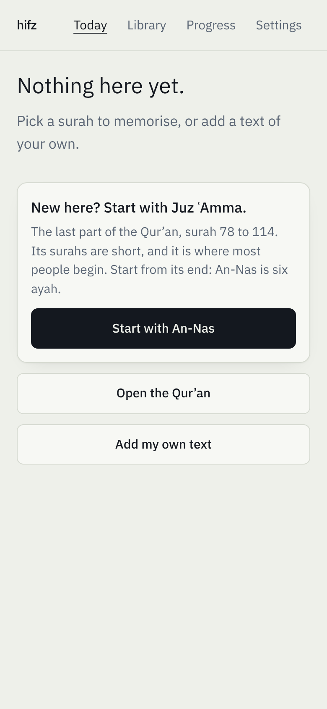
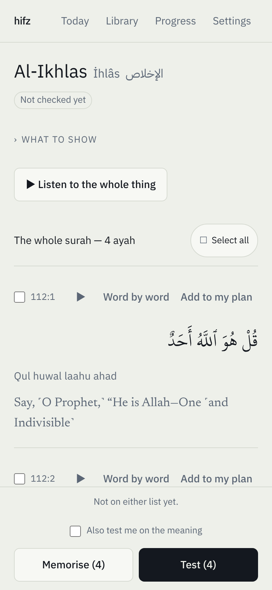
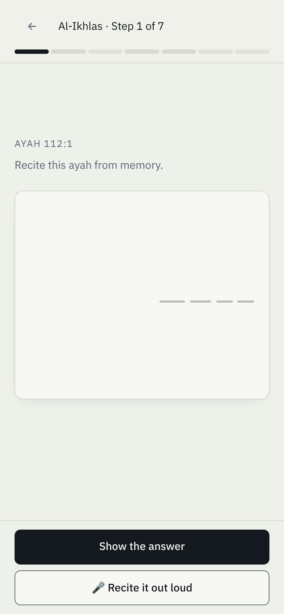

# hifz

A free app for memorising the Qur'an word for word, and keeping it memorised,
for anyone doing hifz in English or Turkish.

### **[Open the app →](https://candanumut.github.io/hifz/)**

Works on your phone; add it to your home screen. After the first visit it also
works offline.

<p>
  
  
  
</p>

## What you get

- All 114 surah: Uthmani Arabic, word-by-word gloss, transliteration, and two
  Turkish and two English translations.
- Tests where the ayah is hidden and you recite it from memory, then say
  honestly whether you had it. Tap a single word if you are stuck.
- Spaced review (FSRS): what you knew comes back later, what you missed comes
  back sooner. It also tests the *joins* between ayah, where recitation
  usually breaks.
- It shows you near-identical passages (*mutashābihāt*) you are likely to mix up.
- A monthly "cold check" on things you have not seen for 30 days. No streaks.
- Works for any text: paste a poem, a duʿāʾ or a speech of your own.

More detail: [How hifz works](docs/HOW-IT-WORKS.md).

## Private by design

There is no account and no server. Your plan and your history are stored only
in your browser (IndexedDB) and never leave your device. The app itself, the
fonts and the Qur'an text are served from GitHub Pages. Recitation audio is
streamed from quranicaudio.com when you press play. The optional "recite out
loud" feature downloads a speech model of about 150 MB from a third party the
first time you turn it on; your voice is processed on the device and never
uploaded ([details](docs/RECITATION.md)).

## Run it yourself

```sh
npm install
npm run dev          # http://localhost:5173
npm run build        # static files in dist/ — deploy anywhere
npm test             # engine tests
npm run check:packs  # validate the bundled content against docs/pack-schema.md
```

`main` deploys to GitHub Pages on every push. One build serves a domain root
and a project sub-path alike — relative asset paths and a hash router, no
rebuild for a different base.

`/#/design` is the ink-fade bench: one ayah at all five levels in both themes,
kept in the app so the fade can be re-judged after any change to type or
tokens.

## Content

The whole Qur'an ships with the app — all 114 surah, in one pack — with
Uthmani text, word-by-word gloss, three transliterations, two Turkish and two
English translations, and word-level recitation timings.

Transliteration is stored separately from translation, because it is the same
text in another script rather than its meaning. Three editions: **Readable**
(`Qul huwal laahu ahad`), **Scholarly** (`Qul Huwa Allāhu ʾAĥadun`), and
**Word-aligned** (`qul huwa l-lahu aḥadun`), which has one token per Arabic
word and so highlights in step with the recitation. It shows while you are
learning and once an answer is revealed — never as a hint during a test, since
it is the line itself.

Packs are static JSON snapshots taken at build time. **The app never calls an
upstream API at runtime**, so it works offline and no donation-funded server
carries our traffic.

```sh
npm run build:packs                       # rebuild both packs
npm run build:packs -- --pack=juz-amma    # just one
npm run build:packs -- --reciter=6        # different reciter's word timings
```

Sources, editions and their terms are listed in
[`docs/CONTENT-SOURCES.md`](docs/CONTENT-SOURCES.md). Thanks in particular to
[Açık Kuran](https://github.com/acik-kuran/acikkuran-api), the volunteer
project behind the Turkish text, to the
[Quran.com / Quran Foundation API](https://api-docs.quran.foundation) for the
Uthmani text and word-by-word gloss, and to
[quran-api](https://github.com/fawazahmed0/quran-api) for the translation
mirrors.

**Writing your own pack** — a dīwān, a hadith collection, a set of poems — only
means producing JSON in the documented shape:
[`docs/pack-schema.md`](docs/pack-schema.md). Contributions welcome.

## How it is built

Vite · React · TypeScript · Tailwind · Dexie (IndexedDB) · `ts-fsrs` · Zustand ·
React Router. No backend. Fonts are self-hosted under `public/fonts`, so the
built app makes no third-party request at all until you press play on audio.

```
src/engine/   data model, FSRS wrapper, item generation, evidence tiers,
              segmentation, the interference graph, recitation matching
src/db/       Dexie schema and every read and write
src/packs/    pack loading
src/routes/   Today · Library · Text detail · Review · Cold check · Add · Progress · Settings
src/components/ InkText (the fade), heat strips, response modes
scripts/      pack and font snapshots
```

Attempts are append-only. Nothing in the history is ever deleted — the honesty
of the evidence tiers depends on it, and later work (weak-word analysis,
browser-side recitation scoring) will read from it.

## Licence

MIT for the code. Bundled content carries its own terms, recorded in each pack
and in [`docs/CONTENT-SOURCES.md`](docs/CONTENT-SOURCES.md).
